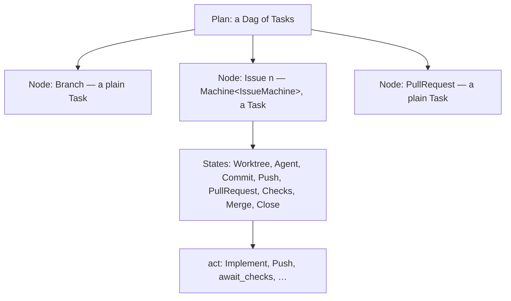
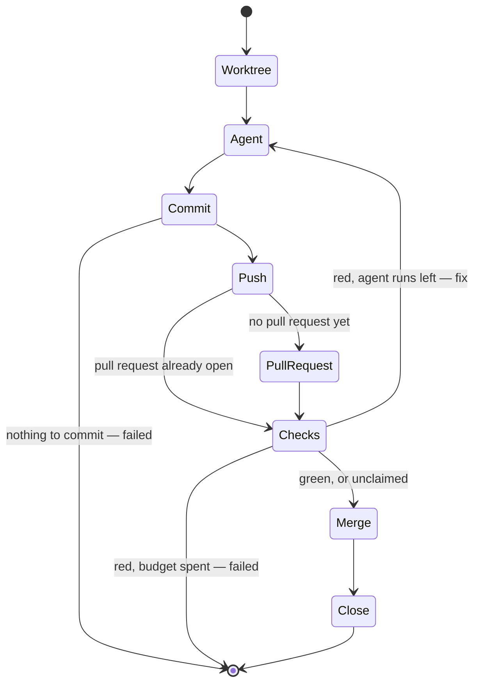

# ADR: Task Machines — loops inside a node, the DAG untouched

- **Status:** Accepted
- **Date:** 2026-09-24
- **Source:** Design conversation (Cowork), September 2026. The name and the
  first idea are Bill's; a sketch of the two traits is in the `TaskMachine`
  scratch repository beside this one.

## Context

An issue's node in a feature build is a straight line:
`epik_core::plan::feature::Issue::run` awaits `Worktree`, `Agent`, `Commit`,
`Push`, `PullRequest`, `Checks`, `Merge` and `Close` in order, and the first
failure is the issue's. A red check is terminal — `await_checks` bails with
`checks failed on {sha}` — and whatever waited on the issue is skipped.

`issue.md`, the slash command this build ports, does not stop there. Step 4b
watches the pull request and fixes what goes wrong: a red CI run, a conflict,
a stale base. `2026-09-20-epik-does-everything-around-the-code` took steps 4–7
away from the agent and gave them to deterministic `Task`s, and accepted the
cost in so many words: "a red check is not fixed by the agent that caused it
in the context it still holds. Remediation is a second run." That second run
has not been built, so today a build can only be as good as an agent's first
attempt.

Remediation is a loop — push, check, fix, push, check again — and a `Plan` is
a `Dag`. The loop cannot be an edge of it.

## Decisions

### A Task Machine is a Task

A **Task Machine** is a small state machine whose states are tasks. It
implements `Task`, so it stands wherever a task stands, and a `Plan` holding
one is still a `Dag` of tasks. `Plan`, `Dag` and `execute` do not change.

Containment is strict and has three levels:



**A loop never crosses a node boundary.** Every back-edge lives inside one
machine; the plan sees a node's final outcome and nothing else. A node that
is still looping has not finished, so the edges that mean "after it" hold,
and the `Dag` stays acyclic because it never sees a cycle. Two consequences
are accepted:

- **A retry cannot reach upstream.** An issue whose checks go red because an
  issue it waited on merged something broken can fix only its own branch. A
  finished node is a fact.
- **Not every node is a machine.** `Branch` and `PullRequest` stay plain
  tasks. Nothing requires wrapping a single task as a one-state machine.

Nesting a `Plan` inside a state is possible — `execute` is only a future —
and is not done. Nothing asks for it.

Rejected: loops as edges of the plan. `Dag` refuses cycles by construction,
and a plan whose edges can repeat has no "first failure in node order" and no
"a failure holds back only what follows it". Rejected: unrolling each retry
into further nodes (`Checks₁`, `Fix₁`, `Checks₂`, …). The budget would be
fixed in the graph's shape, the graph would be unreadable, and the `Merging`
state `2026-09-20` kept one node per issue to preserve would stop meaning
anything. Rejected: leaving the loop to the agent — polling CI from inside a
model's session, which `2026-09-20` already rejected on cost and on
observability.

### A machine acts, then decides; deciding is pure

```rust
pub trait TaskMachine: Send + Sync {
    /// Where the machine is, and what it carries there: the commit, the
    /// pull request, the worktree, the attempt.
    type State: Send;
    /// What acting in a state produced, as a value.
    type Outcome: Send;

    fn start(&self) -> Self::State;

    /// The state's work. An error is a failure the machine cannot branch on.
    fn act(&self, state: &Self::State) -> impl Future<Output = Result<Self::Outcome>> + Send;

    /// Where to go from `state` given `outcome`: no I/O, no clock, no git.
    fn next(&self, state: Self::State, outcome: Self::Outcome) -> Next<Self::State>;
}

pub enum Next<S> {
    Go(S),
    Done,
    Fail(anyhow::Error),
}

/// A machine run as a task: act, decide, repeat, until Done or Fail.
pub struct Machine<M>(pub M);

impl<M: TaskMachine> Task for Machine<M> { … }
```

Doing and deciding are separate so the transition table can be tested as a
table. `next` is a pure function over values, in the spirit of the monitor's
fold: a red verdict on the second attempt goes back to the agent, and on the
last attempt fails the issue, and neither claim needs git, a fake GitHub or a
process to state. The integration tests then have one job — that the wiring
turns red-then-green into a merge — rather than exercising every edge.

`State` is moved through `next`, never cloned, because the issue's state owns
a `LinkedWorktree`, which is `Drop`-owned.

`act` is async and fallible in `anyhow`, as `Task::run` is. The sketch's
synchronous `Task<E>` and its `TaskStatus<E>` are not carried over; what
survives of `TaskStatus` is the next decision.

Rejected: a transition that performs the work and returns the next machine,
as the sketch's `EmitterChain` does. The sketch is a toy for exercising the
traits, not a design, and combining the two puts I/O in the only function
that could otherwise be tested without any.

### What a machine branches on is a value; an error is what it cannot

A pure `next` cannot downcast an `anyhow::Error` or read an error's words. So
every outcome a transition distinguishes becomes a variant:

- `Verdict` gains `Red(names)` beside `Green` and `Unclaimed`; `await_checks`
  stops bailing on red. Still-pending at the bound stays an error.
- A merge GitHub refuses as not mergeable becomes a `Refused` outcome.
- `NothingToCommit` becomes an outcome of the commit step rather than an
  error found by `is::<NothingToCommit>()`.

Everything else — a network failure, a git command that dies, a worktree off
its branch — stays an `anyhow` error from `act`, and an error from `act` is
the machine's failure. Retrying transient failures is not decided here.

### An issue is a machine



The first cut builds this machine: today's eight steps with one back-edge,
from a red `Checks` to a fixing `Agent`. On the way round, `PullRequest` is
skipped — the one already open follows the branch — and the state carries
its number.

A second back-edge fits the same machine and is named here but not built:
`Merge` refused as not mergeable goes to an `Integrate` state that merges
`origin/feature-N` into the issue's branch in its worktree, then to `Push` if
that merge was clean or to a resolving `Agent` if it conflicted. It is the
third position in `2026-09-23-where-a-feature-accumulates` — integrate
locally, check and merge on GitHub — and it arrives as one state and two
edges rather than a new design. It waits on that entry's question being
decided.

### The worktree lives as long as the machine

`Issue::pushed` drops the worktree as soon as the push returns, which leaves
nothing to fix in. The `LinkedWorktree` moves into the machine's state from
`Worktree` onwards and is given back when the machine reaches `Done` or
`Fail`. A panic drops it as it does today.

This is the same direction as the clone-lifetime change agreed in the #253
review, which `2026-09-23-where-a-feature-accumulates` records as worth taking
either way.

### One budget per issue, counted in agent runs

The state carries the attempt. The budget is the number of times the machine
may enter `Agent`, across every loop it has: an issue's first run and its
fixes draw on the one count. It is three to begin with, a constant beside
`SLOTS`.

Agent runs are what cost money, so they are what is bounded. Rejected: a
budget per loop, which lets an issue that alternates between red checks and
refused merges spend the sum of both.

### A fix resumes the agent's session

A fixing run is `claude --resume <session>` in the same worktree, briefed
with what went wrong: the names of the red checks, and their output once the
GitHub client reads it. The session id is the one `Update::Session` carried
on the issue's first run. The agent comes back holding what it built and why,
rather than rediscovering it from a diff.

This **revises** the cost `2026-09-20-epik-does-everything-around-the-code`
accepted — "a red check is not fixed by the agent that caused it in the
context it still holds". It now is. The rest of that decision stands: the
agent never watches CI, never holds a GitHub token, and never merges. Epik
decides that a fix is due and what it is told.

If the resumed run cannot start — the session is gone, or the CLI refuses it —
the fix runs fresh, briefed with the issue, the branch's diff against the
feature branch, and the failure. A resumed session that has grown too long
for the model is the risk accepted; the fresh run is also its remedy.

Consequences in `agent::claude`: `ClaudeCode` gains an optional session to
resume, and its pinned argument list gains `--resume <id>` when there is one.
The agent's step yields the session id to the machine as an outcome — a value
that stays inside one node, which leaves `2026-09-20`'s "no value travels
between nodes" intact.

### Retries re-enter the same steps; only the issue's own failure is terminal

`Step`'s vocabulary does not change. A retry re-enters `Agent`, `Commit`,
`Push` and `Checks`, and each entry is reported under its `Name::Step` as now.

What changes is what a failure means. A step's `Failed` is that attempt's; the
issue's own `Failed`, under `Name::Issue(n)`, which `Reported` already emits
when the machine fails, is the issue's. The monitor's fold stops treating the
first step to fail as the issue's end (`failed.get_or_insert_with` in
`heard`) and reads the issue's node instead.

The fold already divides Running from Merging by step order
(`step > Step::Push`), so an issue that goes back from `Checks` to `Agent`
reads as Running again — holding a slot, as it is. The fold gains a count of
attempts, the times `Agent` has started, for the window to show.

## Consequences

- A `plan::machine` module in `epik-core` holds `TaskMachine`, `Next` and
  `Machine`. `plan::feature::Issue` becomes a `TaskMachine`; `Node::Issue`
  holds it as `Machine<…>`.
- `plan::github`: `Verdict::Red`; `await_checks` returns red as a verdict;
  a refused merge is an outcome.
- `plan::commit`: nothing to commit is an outcome.
- `agent::claude`: `ClaudeCode` resumes a session when given one.
- `monitor`: an issue fails on its own node's `Failed`; attempts are counted.
- The fix brief is written beside the issue brief. Neither names a slash
  command, per `2026-09-20`.
- The `Integrate` edge waits on `2026-09-23-where-a-feature-accumulates`.
