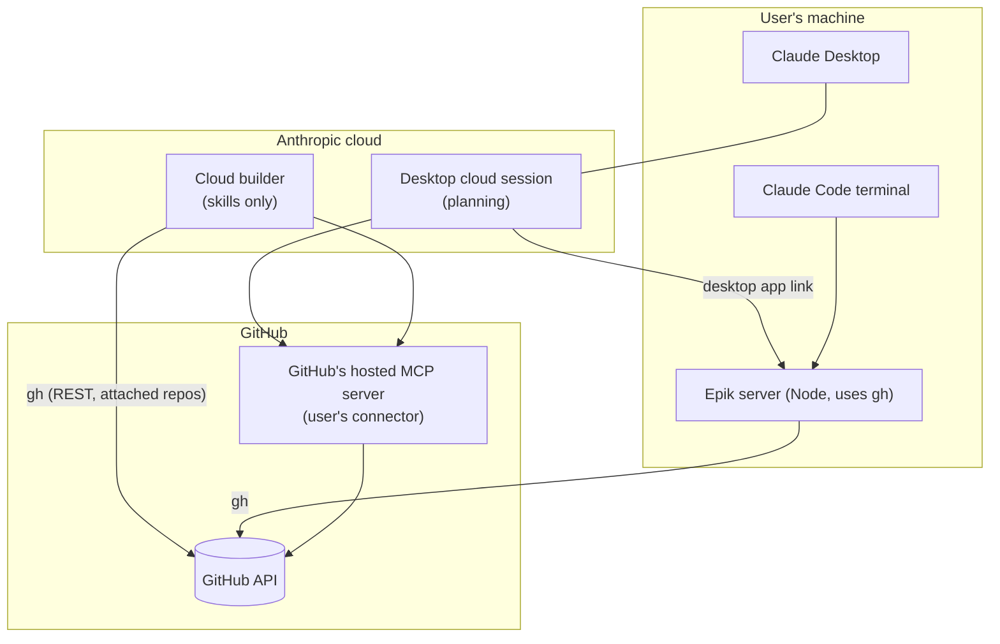

# One plugin, standard GitHub, Epik-only tools

- Status: Accepted
- Date: 2026-10-24

## Context

Epik does three kinds of work:

1. **Discussion.** A chat session converges on a design.
2. **GitHub reads and writes.** The session authors the epic's issue graph
   and reads its status.
3. **Building.** A Claude Code session implements the epic's issues and
   merges them.

It has to be reachable from **Claude Desktop** and the **Claude Code
terminal**. Web and mobile chat are explicitly given up.

The constraints:

- **Standard installation.** Epik installs the way other applications of
  its type install, and needs no setup outside its own beyond what a
  typical one needs.
- **No hosted service, no custom secrets.** Epik runs no server and holds
  no user's credentials ([presence-not-a-connector](2026-07-28-presence-not-a-connector.md)).
- **No duplicated code.** Epik reuses standard official releases. Where
  they fall short, Epik adds to them rather than accepting their limits.
- **Nothing non-standard.** No undocumented settings, no overrides of
  platform behavior.

Product names in this area have changed often, so this entry describes
mechanisms. A **cloud session** runs in Anthropic's cloud. A **local
session** runs on the user's machine. A **plugin** is a folder of skills
and server definitions. An **extension** (`.mcpb`) is a packaged local
server that the desktop app runs with its own Node. A **connector** is a
remote MCP server added to the user's claude.ai account.

### Findings (probes run 2026-10-24)

| Question | Finding |
|---|---|
| Do Desktop cloud sessions linked to the user's computer reach a plugin's local server? | **Yes.** The desktop app starts it on the user's machine with the **user's own Node** and forwards it to the session. |
| Do cloud sessions launched as builders run plugin servers? | **No.** Account plugins sync and their **skills load**, but plugin MCP servers are switched off (`CLAUDE_CODE_SKIP_PLUGIN_MCP_SERVERS=1`). |
| What GitHub access does a cloud builder get? | `gh` and git through Anthropic's GitHub integration: REST only, scoped to the repositories attached to the session. **GraphQL is blocked**, and so are organization- or user-scoped paths, including GitHub's Projects REST API. Sub-issue and blocked-by REST endpoints work. |
| Can a plugin declare GitHub's hosted MCP server? | **Only at the plain URL.** In Desktop, `https://api.githubcopilot.com/mcp/` attaches to the user's existing GitHub connector. The toolset URLs (`/x/projects`, `/x/labels`, `/x/actions`, `/x/all`) cannot sign in. GitHub's sign-in server supports neither dynamic client registration nor Claude's published identity, so they would need a registered GitHub app's client ID. |
| Does GitHub's hosted server sign in from the Claude Code terminal? | **No**, for the same reason: no dynamic client registration. The terminal uses `gh`, which ships its own registered client. |
| What does the default GitHub connector lack? | Issue dependencies (blocked-by), Projects, Actions runs and logs, and label list, create and delete. |

## Decision

### 1. Epik is one plugin

The plugin contains **skills** and a **local MCP server written in Node**.
There is no Desktop extension, no Python, no `uvx`, no hosted server, and
no Epik GitHub OAuth app. Node is the runtime because local MCP servers
always need one, and Node is the most common choice.

### 2. GitHub access comes from standard pieces

- **Shell and Epik's server** use `gh`, signed in with `gh auth login`.
- **Desktop sessions** use the user's own GitHub connector for standard
  GitHub operations. The plugin may declare GitHub's server at the plain
  URL, which attaches to that connector. It never declares toolset URLs.

### 3. Epik's server provides only what the default connector lacks

| Area | Tools |
|---|---|
| Issue dependencies | blocked-by set, remove and list; `epic_status` |
| Projects | list projects, list items, get item, set status |
| Actions | list runs, get run, get logs |
| Labels | list, create, delete |
| Escape hatch | `gh_raw` |

Issue CRUD, comments, sub-issues, pull requests and repository metadata
are **not** in Epik's server. The connector provides them in Desktop, and
`gh` provides them everywhere else. Epik's server prefers REST wherever
GitHub offers it. Projects are GraphQL-only.

### 4. Where each kind of work runs

- **Planning** runs in Desktop cloud sessions linked to the user's
  computer, with the full plugin. The Epik server runs on the user's
  machine, so the machine must be awake.
- **Building** runs in **cloud builders by default**. They have Epik's
  skills, `gh` (REST) and the GitHub connector, but **no Epik tools**.
  Builds continue with the laptop closed and can be followed from any
  device. Local Claude Code builds remain supported, with Epik's tools.

### 5. Determinism grows as scripts beside tools

Today the `epic` skill leaves dependency ordering to the model. When
builds need deterministic ordering, Epik's tree-walking logic becomes one
module with two entry points:

- **An MCP tool** (`epic_status`) for planning sessions.
- **A command-line script** inside the skill's own folder, run as
  `node ${CLAUDE_PLUGIN_ROOT}/skills/epic/scripts/…`, which also works in
  cloud builders.

The script never goes in a top-level `bin/`, because claude.ai refuses to
install plugins that have one. The script answers "what can start now?"
and holds no state. Claude stays in charge of the build.

### 6. "Feature" becomes "epic"

A dependency-ordered set of issues is an **epic**. Accordingly:

- `/epik:feature` becomes `/epik:epic`.
- `feature_status` becomes `epic_status`.
- The parent issue is the **epic issue**, and its integration branch is
  the **epic branch**.
- The epic issue carries an **`epic` label**. GitHub has no such default
  label, and its default issue types (Task, Bug, Feature) have no Epic
  type either. Epik creates the label in the repository on first use,
  so applying it needs no setup from the user.

"Feature branch" keeps its generic git meaning in the working
conventions. Earlier entries in this history keep their original wording.

### User setup

1. Node installed.
2. `gh` installed, and `gh auth login` run, accepting git credential setup.
3. For Desktop sessions: the GitHub connector connected, and the desktop
   app running on the machine that hosts Epik's server.
4. For local builds: Claude Code and a clone of the repository.

## Options considered

| Option | Verdict | Reason |
|---|---|---|
| Hosted remote MCP server | Rejected | Owned infrastructure and custody of user tokens, for reach (web and mobile) that has been given up. The [presence](2026-07-28-presence-not-a-connector.md) reasoning stands. |
| Desktop extension (`.mcpb`) as the main package | Rejected | Desktop only, and the directory no longer accepts extension submissions. Its one advantage, bundled Node, doesn't justify a second package now that plugins reach Desktop sessions. |
| GitHub's server with all toolsets, declared by the plugin | Rejected | The toolset URLs need a registered GitHub app client ID to sign in. |
| An Epik GitHub OAuth app | Rejected, again | Reaffirms [github-app-as-credential](2026-07-29-github-app-as-credential.md): Epik does not sign users in. That entry's separate bot-identity App for automation is untouched. |
| Overriding `CLAUDE_CODE_SKIP_PLUGIN_MCP_SERVERS` in cloud | Rejected | An undocumented override of deliberate platform behavior. Non-standard. |
| Python server kept | Rejected | Needs `uv` and Python on top of the runtime question. The plugin currently installs from a private repository, unpinned. |

## Consequences

- **Installation is one plugin plus ordinary developer tooling** (Node,
  `gh`). Nothing Epik-specific is configured outside the plugin.
- **Half of the current server's 28 tools are deleted** (issues,
  sub-issues, pull requests and repository metadata, 14 in all). The
  server shrinks to dependencies, Projects, Actions, labels and the escape
  hatch.
- **Cloud builders have no Epik tools.** Anything a build needs from Epik
  must reach it as a skill or as a script a skill runs.
- **The Projects board can't be moved from cloud builders.** GitHub's
  built-in workflows set Todo and Done but not In Progress. Moving cards
  from builds would need a repository Actions workflow holding a
  project-capable token. Deferred.
- **Web and mobile chat are unsupported**, by choice.
- **Unverified:** what a Desktop user with no GitHub connector sees when
  the plugin declares the plain URL. The clean-slate install test settles
  it.
- **Supersedes** the Desktop extension as a distribution path, and the
  Python EpikMCP of [consolidate-single-mcp](2026-06-27-consolidate-single-mcp.md).
  The idea of a single Epik MCP survives, as the Node server.
