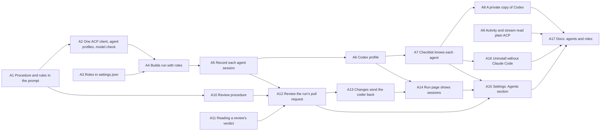

# Epic: Agents and roles — Codex beside Claude Code, a model per role, and a review of every build

Draft plan, 2026-10-30, revised after a review against the code. No issues
are filed. Each section is what its issue would say, written so an agent
could build it from the issue alone. It assumes 0.3.0 has landed, including
the polish epic #458 (`stream.rs`, the Settings page, the sidebar). Paths
and line numbers are from `origin/epic/458-…`.

## Goal

The user picks, in Settings, which agent and model codes each issue and
whether, and with which agent and model, each build's pull request is
reviewed and fixed before it reaches them. Claude Code and OpenAI's Codex
are the agents. Builds stop depending on Epik's plugin.

## In scope

- The procedure and Epik's rules travel in the prompt; `plugin_dir` leaves
  builds.
- One ACP client, with an agent profile per agent; Claude Code and Codex.
- Roles in `~/.epik/settings.json`: coding (agent, model) and review (off,
  or agent and model). A build request may carry roles; builds record and
  reuse them.
- Each agent session an issue takes is recorded: role, round, agent, model,
  time, cost.
- Setup checklist items for Codex, needed only when a build's roles use it,
  and a private copy of Codex.
- Activity and the live stream read plain ACP tool calls.
- Review of the run's pull request when the build is done, with up to
  two rounds of fixes. An epic never pauses for a review.
- Settings page: an Agents section.
- Uninstall works on a machine without Claude Code.

## Out of scope

- Planning with Epik in Codex's client (the design role): a later epic,
  sketched in `plan.md`.
- A price table for agents that report no cost.
- Roles per repository, and a `build_start` argument to pick an agent.
- A native `claude -p` agent beside ACP.
- Any agent not reached over ACP.

## What it leaves behind

A user can switch coding to Codex in Settings, build an epic, and watch
each Codex agent's commands and edits stream on the run page. Its issues
merge into the epic branch as with Claude Code. Their comments show time,
with cost "not reported by Codex". With review on, the build's pull
request gets a review comment when the build is done, and a change
request sends a coding agent to address it before the pull request
reaches the user.

## Graph

A1, A3, A9 and A11 have no blockers and build in parallel. A14 and A15
both edit `pages.rs` and the Settings page's neighbors, so A14 goes first.

---

## A1. Give each agent the issue procedure and Epik's rules in its prompt, not through the plugin

**Why.** Each issue's agent loads Epik's Claude Code plugin from the build
request's `plugin_dir`, so that `/epik:issue <n> <branch>` expands to the
procedure. Only Claude Code loads Claude Code plugins, and a build on
another machine would need the plugin installed there. The prompt can
carry the procedure. Agents also lose nothing by not loading the plugin,
except Epik's rules, which the prompt then has to carry too.

**What.**
- Embed `plugin/skills/issue/procedure.md` and
  `plugin/skills/assistant/rules.md` in `epik-core` with `include_str!`.
  `Build::build_issue` (`build.rs:469`) builds the prompt: a short header
  (repository, issue number, target branch, that no one will answer
  questions), the rules, then the procedure, each in its own words. The
  header is built from a value saying what the work is, of which "issue
  #n" is the first variant: A13 adds "address the review on pull request
  #n", and a later release adds a task given in words with no issue (an
  ad hoc build, noted in `plan.md`). The function takes the variant, not
  an issue number.
- `AgentRequest` gains `issue: u64`, so fakes don't parse the prompt
  (`build.rs:732-735` today).
- `ClaudeAcp` no longer sends `_meta.claudeCode.options.plugins` on
  `session/new`.
- Remove `plugin_dir` from `build::Request`, `Builds::start`, `Build`,
  `AgentRequest`, `Request::Build`, `BuildState` (`record.rs:383`) and the
  `BuildStarted` event. Old records still read: unknown fields are ignored.
  `Rerun` no longer needs it. The MCP `build_start` tool stops sending it,
  and `mcp::Context::plugin_dir` and its `CLAUDE_PLUGIN_ROOT` read go.
- Update `docs/app-protocol.md`.
- `/epik:issue` stays as it is, for building by hand.

**Tests first.** In `build.rs`'s tests: the prompt holds the issue,
branch, rules and procedure text. In `tests/claude_acp.rs`, which already
logs what the fake agent receives (`claude_acp.rs:88-97`): `session/new`
carries no plugins. Build tests no longer pass a plugin directory.

**Out.** Rewriting the procedure or the rules.

---

## A2. Run every agent through one ACP client configured by an agent profile, and check its model before work starts

**Why.** `ClaudeAcp` is the only agent, and what is Claude-specific in it
is data: the adapter's command, the unattended mode's id (`auto`), and that
it reports cost. A second agent should be a second profile, not a second
client.

**What.**
- Rename `ClaudeAcp` to `AcpClient` (`AcpAgent` is already the crate's
  name, imported at `agent.rs:22`) and give it an `AgentProfile`: `id`
  (`claude`), name (`Claude Code`), adapter command, the unattended mode
  id, extra environment variables, whether it reports cost, and the quiet
  period: how long the agent must send nothing after its prompt returns
  before the session is closed (`agent.rs:112-120` today, a field of the
  client; it moves into the profile because only Claude Code's background
  subagents need it). `AgentProfile::claude()` is today's settings, pinned
  at `@agentclientprotocol/claude-agent-acp@0.99.0`, with 300 seconds.
- `AgentRequest` gains `model: Option<String>`. After `session/new`, with
  a model given, find the session config option whose `category` is
  `model` (else whose `id` is `model`) and set it with
  `session/set_config_option`.
- `Agent::check(cwd, model) -> Result<(), String>` opens a session with no
  prompt and drops the connection: the unattended mode exists, and the
  model, if given, is among the option's values. Its errors name the agent
  and list what it offers. It starts the adapter, so it takes a few
  seconds; that is accepted, and nothing is cached between it and the
  session that does the work. (`Builds::start` calls it in A4.)
- The no-auto-mode error names the profile's agent and mode.

**Tests first.** `fake-acp-agent` gains `--models <a,b>` (a `model`
config option) and logs `set_config_option`. Tests: an offered model is
set; `check` with one not offered fails with the list; no model sets
nothing; `check` with no unattended mode fails naming it. The existing
`claude_acp.rs` tests pass against `AcpClient` with the Claude profile.

**Out.** A second profile. Settings. The UI.

---

## A3. Keep each role's agent and model in `~/.epik/settings.json`

**Why.** The user is to choose an agent and model per role, and the app
needs somewhere to keep the choice.

**What.** New module `epik_core::settings`, in the pattern of
`repositories.rs`: `~/.epik/settings.json`, read with defaults when absent,
written atomically. Shape:
`{"coding": {"agent": "claude", "model": null}, "review": null}`. `review`
is `null` (off) or `{"agent": …, "model": …}`. An unknown agent id is an
error on read, naming the known ones (only `claude` until A6). Tauri
commands `settings` and `set_settings` in `epik-app/src/main_window.rs`,
and an `epik_view::AgentSettings` type, for the window (A15).
`~/.epik/config.toml` on some machines is left from Epik's earlier Rust
version and is not read.

**Tests first.** Round trip, defaults, unknown agent, an atomic write that
leaves no partial file.

**Out.** Using the roles (A4). The Settings page (A15).

---

## A4. Build with the roles: from the request, or from settings, recorded and reused

**Why.** A build should run each role with the agent and model chosen for
it, and a rerun should repeat what the first build did. A build forwarded
to another machine (the remote hosts epic) has to carry the roles it was
started with, since that machine has its own settings.

**What.**
- `Request::Build` gains optional `roles` (the shape of
  `settings.json`). Absent, the app uses its settings. Document it.
- `Builds` holds a way to make an agent from a profile and model, instead
  of one `agent` (`builds.rs:44`). `Builds::start` makes the coding agent,
  and the review agent when review is on, and calls `check` on each (A2)
  beside the setup refusal, before `build::start`. A failure refuses the
  build the way a missing setup item does: an error reply naming the
  agent, the model and what it offers, and no record, no clone. (The
  build's `problems` are written after the clone and `build_started`,
  `build.rs:239-283`, and would leave a failed run to delete.)
- `BuildStarted` records `roles`. `Rerun` uses the recorded roles, not
  the current settings. Records without `roles` mean Claude Code with its
  default model and no review.

**Tests first.** With the fake GitHub and agents: a build without roles
uses the settings; with roles, uses those; a rerun after the settings
change uses the recorded ones; a failed `check` refuses the build with the
reason, writes no record and starts no agent.

**Out.** Running review (A12). Recording sessions (A5).

---

## A5. Record each agent session an issue takes

**Why.** With review, a run takes sessions beyond its issues' coding
sessions: a review of its pull request, a fix, a review again. Today one `IssueFinished` carries the agent's time
and cost, the fold keeps the last one (`record.rs:492-506`), and activity
reads only `<n>.jsonl`. Each session needs its own record so that time and
cost add up and the window can show who did what.

**What.**
- Events `SessionStarted {number, role, round, agent, model, log}` and
  `SessionFinished {number, role, round, duration_ms, cost_usd}`. `role`
  is `coding` or `review`; `log` is the session's file name (`<n>.jsonl`
  for the first coding session, as today). `number` is the issue the
  session worked on; the run's own sessions (A12's review, A13's fix)
  carry the run's number, which for an epic is the epic issue's.
  `IssueFinished` keeps the outcome, reason and pull request.
- The fold gives each `IssueState` its `sessions`, and its duration and
  cost as their sums. Records with no sessions fold as today.
- Activity (`run.rs:312-313`) and the stream read the latest session's
  log, for an issue that is running or, from A12, reviewing.
- The issue comment (`comment.rs`) names the agent and model of each
  session.
- The protocol's `status` gives each issue's `sessions`. Update
  `epik_view` and `docs/app-protocol.md`.

**Tests first.** Fold: one coding session gives today's figures; three
sessions sum; an old record without sessions folds as before. Activity
reads the latest session's log. Comment wording.

**Out.** Review (A12). The run page's list of sessions (A14).

---

## A6. Add Codex as an agent

**Why.** OpenAI's Codex is the second agent. Its ACP adapter,
`@agentclientprotocol/codex-acp`, runs `codex app-server`.

**What.**
- `AgentProfile::codex()`: id `codex`, name `Codex`, command
  `npx -y @agentclientprotocol/codex-acp@<pinned, 2.5.0 when checked>`,
  no `CODEX_PATH`: the adapter runs the Codex it depends on
  (`@openai/codex` 0.165). The unattended setting is the session mode
  `agent`, whose automatic reviewer answers approvals (the probe built #13
  this way; decided 2026-10-31 over `agent-full-access`). It is a plain session mode, so
  `agent.rs:198-215` works unchanged. A prompt that fails with
  `codexErrorInfo` (such as `usageLimitExceeded`) records that reason, not
  "Internal error". Reports cost: no. Quiet period: 5 seconds. The probe
  saw nothing arrive after `end_turn`, and Codex has no background
  subagents, so Claude's 300 seconds would only add five minutes to every
  Codex session, and with review on an issue has up to four of them.
- Settings and roles accept `codex`.
- An unreported cost is never zero. The comment's audit block writes
  `null` for it (`comment.rs:35` writes zero today, which also misreports
  an interrupted Claude Code session). `BuildState` and
  `RunState` count the issues whose cost wasn't reported, rather than
  adding nothing (`run.rs:226`). Wherever cost is shown, an issue says
  "not reported by Codex" and a total says "plus N issues not reported".

**Tests first.** `fake-acp-agent` gains `--no-cost` (it already has
`--modes`). A Codex-profile run in its unattended setting succeeds with
no cost; without it, `check` fails naming Codex's setting. Comment, audit
block and totals with a missing cost.

**Out.** Installing or signing in Codex (A7, A8). Reading Codex's tool
calls (A9).

---

## A7. Check each agent a build's roles use

**Why.** The setup checklist knows only Claude Code. A user who codes with
Codex needs Codex installed and signed in, and one who doesn't build with
Claude Code shouldn't be blocked by it.

**What.**
- Items `codex` ("Codex") and `codex-auth` ("Codex sign-in"), after
  `claude-auth`. `codex`: the adapter's Codex runs (it comes with the
  adapter, so this mostly checks Node and the download). `codex-auth`: a
  sign-in in `~/.codex/auth.json`, or the adapter's auth status. Both
  reach the bundled Codex through npm rather than by searching the npx
  cache: `npx -y -p @agentclientprotocol/codex-acp@<pinned> codex
  --version`, and for the sign-in step `… codex login`.
- A build needs `gh`, `gh-auth` and `node` always; `claude` and
  `claude-auth` when its roles use Claude Code; `codex` and `codex-auth`
  when they use Codex. `setup::refusal` takes the build's roles, so a
  build forwarded with roles is refused for what those roles need.
- The `setup` request takes optional `roles` (default: the settings') and
  marks each item `needed`. The checklist shows every item. One not needed
  says "Not needed by your agents" and doesn't hold setup back from
  complete.

**Tests first.** In `setup.rs`'s style, with a recorded runner: Codex
found or missing, signed in or out; which items a build needs for each
combination of roles; `needed` in the reply.

**Out.** Installing Codex (A8).

---

## A8. Install a private copy of Codex

*Probably dropped (probe, 2026-10-31): codex-acp 2.5.0 brings its own
Codex. Keep only if the bundled copy fails in the probe.*

**Why.** Like `gh` and Node, Codex should be installable without a
package manager or administrator.

**What.** In `install.rs`: the latest `openai/codex` release's archive for
this platform, from GitHub's release API. Codex publishes no checksum
file, so the SHA-256 to check against is the asset's `digest` field in the
same API response, which is a different source from `install.rs`'s
checksum lists (`install.rs:83-89,252`). Unpacked to
`~/.epik/tools/codex/`, replacing an older copy only once the new one is
verified, as for the others. The `codex` item's step installs it.

**Tests first.** With local test servers, as for `gh`: the right asset
per platform; a digest mismatch is refused and leaves the old copy; a
release with no digest is refused.

**Out.** Codex's install script, npm or Homebrew.

---

## A9. Read any ACP agent's tool calls in the activity line and the live stream

**Why.** `activity.rs` and `stream.rs` name tools from Claude Code's
`_meta.claudeCode.toolName` and read results from
`_meta.claudeCode.toolResponse`. Another agent's calls show as untitled.
ACP itself has `kind` (`read`, `edit`, `delete`, `move`, `search`,
`execute`, `think`, `fetch`, `other`), `title`, `rawInput`, `rawOutput`,
`locations`, and `content` that can be a `diff` (`path`, `oldText`,
`newText`).

**What.** When `_meta.claudeCode` is absent, describe a call from the ACP
fields: `execute` with `rawInput.command` as "Running …"; `edit` with diff
content as an edit of its path, shown as changed lines (a diff with no
`oldText` is a new file; Codex sends `rawInput` null for edits); `read` and
`search` from `locations` and `title`; `think` calls are skipped by the
activity line and shown by the stream under their title, which for Codex's
automatic reviewer is "Guardian Review". Codex puts a command's output
nowhere standard: `rawOutput` is empty when the client declares no
terminal capability, and the output arrives in `_meta.terminal_output_delta`
with the exit code in `_meta.terminal_exit` (probe, 2026-10-31). The stream
reads those for Codex; when both are absent, a command shows without
output. Claude Code's calls read as today.

**Tests first.** A fixture `codex.jsonl`, cut from the probe's
`runs/agent-mode.jsonl` (a shell command with output and exit code; adding
a file; editing one; a Guardian Review), gives the expected activity lines
and stream entries. Claude's fixture gives what it gives today.

**Out.** Any other agent's `_meta`.

---

## A10. Write the review procedure

**Why.** A review agent needs a procedure, as a coding agent does, and the
app needs the verdict in a form it can read. GitHub refuses approvals and
change requests on one's own pull request, and every agent acts as the
user, so a review is a comment.

**What.** `plugin/skills/review/procedure.md`, and a `review` skill (like
`issue`, `disable-model-invocation: true`) for reviewing by hand: read the
issue (`gh issue view`) and the pull request (`gh pr view`, `gh pr diff`),
from GitHub, since the clone's checkout is the target branch and the
coder's worktree is gone; judge whether the change does what the issue
says (for an epic, the epic issue and its sub-issues, which the header
lists), whether its behavior has tests, and whether it can be explained
in a few sentences, against Epik's rules; post one review with
`gh pr review <n> --comment --body-file <file>`, whose last line is
`<!-- epik-review: approve round=<r> -->` or
`<!-- epik-review: changes round=<r> -->`, with the round the header gave;
for changes, say what to change, specifically; never push, merge, close or
edit. Embed it in `epik-core` as A1 does the issue procedure, with a
function that builds the review prompt (header with repository, issue, pull
request and round; rules; procedure).

**Tests first.** The review prompt holds the pull request number, the
round, the rules and the procedure.

**Out.** Running it (A12).

---

## A11. Read a pull request's review verdict

**What.** `GitHub::reviews(repo, pr)` (with `gh api`, in `gh.rs`, and in the
fake), returning each review's body and submission time. Then
`review::verdict(reviews, round)`: the newest review whose body's last
non-blank line is an Epik verdict marker naming `round`, as `Approve` or
`Changes`; `None` if there is none. The round, not a time, picks the
review: the building machine's clock and GitHub's never have to agree,
and a reader of the pull request sees which review answered which attempt.

**Tests first.** Approve, changes, a marker for another round, a marker
not on the last line, several reviews for the round (newest wins), none.

---

## A12. Review the run's pull request when the build is done, when review is on

**Why.** A second agent, or a second model, reading the change before the
user does catches what the first missed. A build is judged at one pull
request, a single issue's or the epic's, so that is where the review
goes: an epic's issues merge into the epic branch as they finish, and
the build never pauses for a review on the way.

**What.** In `Build::orchestrate`, when the build's roles have review,
once the run's pull request exists (a single issue's, found after its
coding session; the epic's, opened by the build after every issue
merged, `build.rs:420-432`):
- Wait for its checks. Today both finish without waiting
  (`build.rs:416,508-510`); the wait is new, and only with review on.
- Run the review agent in the clone with A10's prompt for round 1, as a
  session on the run's number (`role: review, round: 1`, log
  `<n>-review-1.jsonl`). Then read round 1's verdict with A11.
- Finish the build as today, with the pull request for the user, and
  record the verdict: `BuildFinished` gains `review`
  (`approve`, `changes` or `none`), and `status` shows it. A fix (A13)
  comes between a `changes` verdict and the finish.
- While the review runs, the run's disposition is `reviewing` (protocol,
  fold and `epik_view`).

**Tests first.** With fakes: review off changes nothing; approve finishes
with `review: approve`; changes finishes with the pull request open and
`review: changes`; no marker gives `none`; the build waits for the pull
request's checks first; an epic's issues merge with no review between
them, and the review runs once, after the epic's pull request opens; the
fold shows `reviewing`; time and cost include the review session.

**Out.** Addressing the review (A13). The UI (A14, A15). Review of each
issue's pull request before it merges: deferred, see the record.

---

## A13. Address the review before the pull request reaches the user

**What.** On **changes**, run the coding agent on the run's number
(`role: coding, round: 2`, log `<n>-coding-2.jsonl`), with the issue
procedure and a header that overrides its first steps (A1's second
variant): pull request #<pr> on branch `<head>` is open, so make the
worktree from that branch, address the latest review there, push to it,
and open no new pull request; then wait for the checks as the procedure
says. On an epic that branch is the epic branch, and the push is direct,
as Epik's own merges into it are. Then the checks and a review again
(`round: 2`, with round 2 in its prompt). When the second review still
asks for changes, finish the build with the pull request for the user and
the run needing attention: "the review still asks for changes after 2
rounds; see #<pr>". The limit is a constant.

**Tests first.** Changes, then approve, finishes with `review: approve`
after one more round; changes twice finishes needing attention with the
reason; the second coding prompt names the pull request and its branch
and says not to open another; for an epic it names the epic branch; the
second review prompt says round 2; time and cost sum over all the run's
sessions.

**Out.** A setting for the limit.

---

## A14. Show each issue's sessions on the run page

**What.** The issue panel lists the issue's sessions in order: role,
round, agent, model, time, and cost or "not reported". The run's own
sessions, its reviews and fixes, are listed under the run's header the
same way, with each review's verdict and a link to the pull request's
reviews. The live stream shows the chosen session, the latest by
default. A run in review shows "reviewing" in the run header and in the
runs table's Now line.

**Tests first.** In `epik-app/src/pages/tests.rs` and
`epik-ui/tests/run_page.rs`: a run with review (changes), fix, review
(approve) shows three sessions in order under its header, with verdicts;
a reviewing run; a Codex session's cost wording.

**Out.** Showing a review's text in the window: GitHub has it.

---

## A15. Choose each role's agent and model in Settings

**What.** The Settings page gets an **Agents** section above the
repositories: **Coding** (agent: Claude Code or Codex; model: a text field
whose placeholder is "The agent's default"), and **Review** (Off, Claude
Code or Codex; model), described in a line: "Reviews the build's pull
request when the build is done, and fixes what it finds, up to twice,
before the pull request reaches you." Saving uses A3's `set_settings`
command. When an
agent's setup items aren't done, the section says so and links **Check
setup**. Each agent says, in a line, how it runs unattended: Codex in a
sandbox, with its own reviewer approving what leaves it (A6's mode);
Claude Code with a model approving each risky action, and no sandbox.

**Tests first.** `epik-ui/tests/settings.rs`: the current roles shown;
changing and saving calls `set_settings`; review Off hides its model
field; an incomplete agent shows the setup link.

**Out.** Listing the models an agent offers. A mistyped model is caught
when a build starts (A4).

---

## A16. Uninstall Epik on a machine without Claude Code

**Why.** Uninstalling runs `claude plugin` steps (`uninstall.rs:103`), and
fails where Claude Code isn't installed, which A7 makes possible.

**What.** Skip the plugin steps, saying so, when `claude` isn't found.
Codex itself lives in npm's cache with its adapter, not under `~/.epik`,
so the Tools step is unchanged. (Were A8 kept, the step would name the
private Codex too.)

**Tests first.** In `uninstall.rs`'s tests: no `claude` skips the plugin
steps, says so, and the rest succeeds.

---

## A17. Document agents and roles

**What.** `plugin/skills/assistant/how-it-works.md`: roles, the two agents,
Codex's setup, review and its verdict comment, and what "not reported"
means. `README.md`: a paragraph and the Settings section.
Troubleshooting: a model the agent doesn't offer, a review that keeps
asking for changes. Check that `docs/app-protocol.md` covers every request
and field the epic added.

---

## Before filing: findings to make

These need Bill's go-ahead: each downloads the Codex adapter and spends a
little on OpenAI's API (this Mac's Codex is signed in with an API key).

1. **The Codex probe.** *Done 2026-10-31: built #13 in `agent` mode,
   wpm/epik-test#17; see `probe-codex.md`.* Build one small issue of `wpm/epik-test` through
   codex-acp 2.5.0, driven by a short ACP client, as `wpm/epik-test#13`
   was for Claude. Settles:
   - whether `agent-client-protocol` 3.6 talks to it cleanly;
   - whether its unattended setting is a mode or a config option;
   - whether `CODEX_CONFIG` (workspace-write, `network_access = true`,
     approval `never`) lets `git push` and `gh pr create` through, or only
     `agent-full-access` does;
   - whether the prompt returns before background terminals finish, and
     whether the 300 s quiet period covers it;
   - whether `rawOutput` holds command output when the client declares no
     terminal capability;
   - the `model` option's values.
2. **Prompt against skill, for Claude.** *Done 2026-10-31: 60 s and
   $0.17 from the prompt, 61 s and $0.19 from `/epik:issue`; both opened
   their pull request. A1 stands. See `probe-claude.md`.*
3. **Claude Code's sandbox through ACP.** *Done 2026-10-31: not
   adopted. The adapter takes the SDK's `sandbox` option in
   `_meta.claudeCode.options`, but on macOS `gh` fails TLS against the
   sandbox proxy, and Claude then runs commands with
   `dangerouslyDisableSandbox`, which auto mode approves: 6 of 11
   commands escaped, the build cost $0.26, and nothing reached Epik.
   A2's Claude profile has no sandbox; A15 says Codex runs sandboxed
   and Claude Code doesn't. See `probe-claude.md`.*
