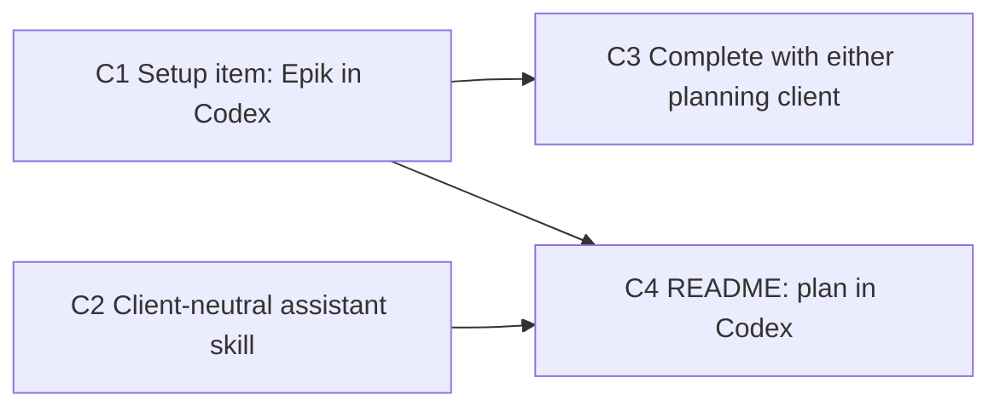

# Epic: Plan with Epik in Codex — the design role for a user with no Anthropic account

Draft plan, 2026-10-31. No issues are filed. Each section is what its
issue would say. It assumes epic A has merged: Codex is an agent, the
checklist has `codex` and `codex-auth` items that a build needs only when
its roles use Codex (A7), and `how-it-works.md` already describes roles
(A17).

## Goal

A user whose roles all use Codex can also *plan* with Epik in Codex's own
client, with no Claude Code on the machine: Epik's assistant skill and
Epik's tools are installed into Codex from the Epik app's checklist, and
the checklist no longer insists on Claude Code when nothing uses it.

## In scope

- A setup item, **Epik in Codex**, that writes Epik's assistant skill to
  `~/.agents/skills/epik/` and registers the app's MCP server with
  `codex mcp add`, and keeps both current across app updates. Uninstall
  removes them.
- The assistant skill's words made client-neutral where they name Claude
  Code, with what differs in Codex.
- The checklist is complete with either planning client set up: the Epik
  plugin in Claude Code, or Epik in Codex.
- README: a section on planning in Codex.

## Out of scope

- Epik in the ChatGPT desktop app or the Codex IDE extension; the CLI is
  the client.
- Driving Epik from `codex exec` (non-interactive Codex), which refuses
  MCP tools that need approval.
- Changing anything about how Codex *builds*; that is epic A.

## What it leaves behind

A user installs the Epik app, sets coding to Codex in Settings, and the
checklist shows **Codex**, **Codex sign-in** and **Epik in Codex**. They
press the last one, open a terminal, run `codex`, and say "Are you Epik?".
Epik answers, and plans, writes epics and starts builds through the same
tools Claude Code users have. Claude Code's items say "not needed".

## Findings (2026-10-31, Codex 0.165 through codex-acp 2.5.0 and `codex exec`, on this Mac)

| Question | Finding |
|---|---|
| Does Codex load a skill with Epik's frontmatter? | **Yes.** `plugin/skills/assistant/` copied to `~/.agents/skills/epik/` (frontmatter `name: assistant`, Epik's description), asked "Are you Epik?" in `codex exec`: Codex chose the skill from its description, read `SKILL.md`, and answered "Yes, I'm Epik. I used the `assistant` skill." No `$` mention was needed. The user-scope directory is `~/.agents/skills`; `~/.codex/skills` is not read. |
| Does Codex call Epik's MCP tools without prompting? | **In its default `agent` preset, yes.** `codex mcp add epik -- ~/.epik/bin/epik-app mcp` writes `[mcp_servers.epik]` to `~/.codex/config.toml`. Asked to call `build_list` and `project_list`, Codex did; each call passed its automatic reviewer ("Guardian Review", about 2 s, "read-only listing, low risk, approved") and nothing reached the client. The MCP server started the Epik app, as it does for Claude Code. |
| And from `codex exec`? | **No.** Its approval policy is `never`, and every call fails with "MCP tool call requires approval, but approval policy is never", even with `default_tools_approval_mode = "auto"` on the server. Planning is interactive, so this doesn't matter; it rules out scripting Epik through `codex exec`. |
| Does `gh` run in Codex's shell? | **In the `agent` preset, through the reviewer**, as every `gh` call in the build probe did. Under `codex exec`'s default read-only sandbox there is no network: `gh` fails with "error connecting to api.github.com". |
| Where does the MCP server's path go? | `codex mcp add` stores the absolute path, so the `${HOME}` expansion that bites Claude Code on Windows doesn't arise. |

Still open: whether the reviewer approves a *mutating* tool, `build_start`
or `issue_set_blocked_by`, as readily as a listing. It approved `git push`
and `gh pr create` in builds, so probably; C1's first use will tell.

## Graph

C1 and C2 have no blockers and build in parallel. C2 follows A17 across
epics, since both edit `how-it-works.md`.

---

## C1. Install Epik into Codex from the checklist

**Why.** A user who builds with Codex and has no Claude Code still plans
in Claude Code today. Codex's CLI has Agent Skills in `~/.agents/skills`
and MCP servers in `~/.codex/config.toml`, so Epik can live there too, and
the checklist is where Epik installs things.

**What.**
- Item `codex-epik` ("Epik in Codex"), after `codex-auth`, listed when a
  role uses Codex (A7's `needed` logic decides what is listed; this item
  is never needed *to build*). Its state is `done` when
  `~/.agents/skills/epik/` holds exactly the embedded skill files and
  `codex mcp get epik` reports the app's path; `outdated` when the files
  differ (the app updated); `missing` otherwise.
- Its step writes the skill: `SKILL.md`, `rules.md` and `how-it-works.md`
  from `plugin/skills/assistant/`, embedded with `include_str!` as A1
  embeds the procedure. The copy's frontmatter `name` is `epik`, so a
  `$epik` mention works in Codex; the description is unchanged. Then it
  runs `codex mcp add epik -- <absolute path of ~/.epik/bin/epik-app> mcp`
  through the bundled Codex (`npx -y -p @agentclientprotocol/codex-acp@<pinned>
  codex mcp add …`, as A7's items do). Adding again replaces the entry.
- `uninstall.rs` gains a step **Epik in Codex**: `codex mcp remove epik`
  and the skill directory, skipped with a note when Codex isn't found.

**Tests first.** In `setup.rs`'s style, with a recorded runner and a
temporary home: missing, outdated (one file differs), done; the step
writes the files and runs the `mcp add` command; the uninstall step
removes both and skips without Codex.

**Out.** Any other Codex client. Refreshing the skill on a timer: the
checklist's state is enough.

---

## C2. Say "the client" where the assistant skill says "Claude Code"

**Why.** The skill tells Epik it is talked to in Claude Code
(`SKILL.md:6`, `how-it-works.md:7,24`) and its troubleshooting assumes
Claude Code's plugin system. In Codex that's wrong, and Epik would explain
the wrong client to the user.

**What.** In `plugin/skills/assistant/`:
- `SKILL.md`: "Claude Code builds those issues" becomes "coding agents
  build those issues"; nothing else there names a client.
- `how-it-works.md`: the opening says Epik is the app plus Epik in the
  client the user talks to it in, Claude Code, Claude Desktop or Codex.
  Setup lists the Codex items and **Epik in Codex** (C1). Planning says
  "in the client" instead of "in a Claude Code session". A short
  **Codex** section beside **Claude Desktop**: the skill lives in
  `~/.agents/skills/epik`, Epik's tools pass Codex's reviewer, and
  `codex exec` can't use them. Troubleshooting entries that are Claude
  Code's say so in their first words; two Codex entries are added: the
  skill doesn't answer (the directory is missing or stale: press the
  item again), and tools fail with "requires approval" (the user ran
  `codex exec`).

**Tests first.** None: these are words. The check is reading the file as
Codex would.

---

## C3. Complete the checklist with either planning client

**Why.** After A7, `claude` and `claude-auth` are needed only when a role
uses Claude Code, but **The Epik plugin** (`Item::Plugin`) still counts
toward completeness (`setup.rs:133`, it is the one item not needed to
build), so a Codex-only user is told setup is incomplete until they
install Claude Code.

**What.** The plugin and `codex-epik` are the two *planning* items. The
checklist is complete when every item needed to build is done and at
least one planning item is. A planning item that isn't done while the
other is says "Not needed: Epik is set up in Codex" (or "… in Claude
Code"), as A7's not-needed items do. The `setup` reply marks `needed`
accordingly.

**Tests first.** Plugin done, Codex item missing: complete; the reverse:
complete; neither: incomplete, both needed; both: complete.

---

## C4. Document planning in Codex

**What.** `README.md`: a short "Plan in Codex" section after the install
steps: set a role to Codex, press **Epik in Codex**, run `codex`, say
"Are you Epik?". A line in the Settings section. Check that
`how-it-works.md` (C2) and the README agree.

---

## Before filing

Nothing to find. The one open question above is answered by C1's first
real use, and the answer changes words, not design.
