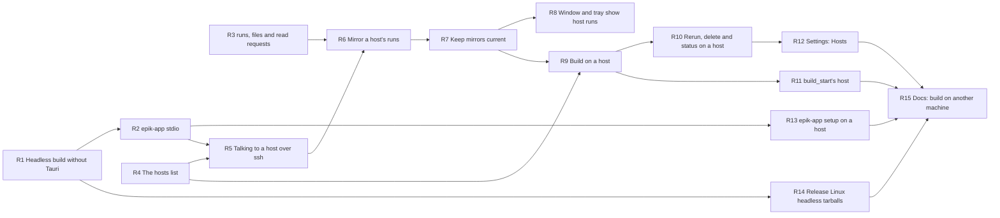

# Epic: Remote hosts — build on another machine and watch it here

Draft plan, 2026-10-30, revised after a review against the code. No issues
are filed. Each section is what its issue would say. It assumes 0.3.0 has
landed and that the agents and roles epic merged first, so builds need no
plugin directory (A1), a build request can carry roles (A4), and setup is
checked for a build's roles (A7). If the order is reversed, A1 moves into
this epic as its root, and R6 forwards no roles.

## Goal

A build can run on another machine the user reaches with `ssh`, keep going
while the laptop is closed, and show in the Epik app, live, as a local
build does.

## In scope

- A headless build of `epik-app` without Tauri, and Linux release tarballs
  of it.
- `epik-app stdio`, the bridge a remote app is reached through, and
  `epik-app setup`, to check and install tools on a host.
- Protocol requests to list a host's runs in full, list a run's record
  files, and read what was appended to one.
- A list of hosts, and a client that talks to one over the system `ssh`.
- A mirror of each host's runs under `~/.epik/hosts/<host>/`.
- The window, tray and conversation show host runs, and start, rerun and
  delete builds on hosts. A default host.
- Settings: a Hosts section.
- Documentation for setting up a host by hand.

## Out of scope

- Signing in on a host from the app, and installing the app on one.
- macOS and Windows release artifacts for hosts.
- Moving a run between hosts.
- Pushing changes from the host instead of polling.
- Any transport but the user's `ssh`.

## What it leaves behind

A user with a Linux machine follows the docs once: download the headless
app, run `epik-app setup` there, sign in over SSH, start the service. They
add the host in Settings, make it the default, and ask Epik to build an
epic. The run appears in the window marked "on devbox", streams live, and
goes on while the laptop sleeps. When the laptop wakes, the window catches
up.

## Graph

R1, R3 and R4 have no blockers and build in parallel. R8 and R9 both
follow R7 and build in parallel: R8 is the window, R9 is `ipc.rs` and
`builds.rs`. R8, R10 and R12 all edit `pages.rs` and `main_window.rs`, so
they are in one line, as are R1, R2 and R13, which edit `main.rs` and
`tests/cli.rs`.

---

## R1. Build `epik-app` without Tauri for machines with no desktop

**Why.** A remote host is usually a server with no desktop. `--headless`
does no desktop work, but the binary links Tauri, so it needs WebKitGTK and
friends installed. Tauri has no headless feature.

**What.** Give `epik-app` a default feature `desktop` that brings in
`tauri`, `tauri-build`, `open` and the window and tray modules
(`main_window`, `navigation`, `pages`, `popover`, `setup_window`, `tray`).
Without it, no argument runs headless, as the desktop build already does
where there is no tray (`tray.rs:44-62`), so `epik-app mcp`'s start of the
app works unchanged. `mcp`, `--headless` and `--version` work as now.
`App` and `reconcile_until` stay shared. `build.rs` runs `tauri_build`
only with `desktop`. CI gains a job on `ubuntu-24.04` that installs **no**
GUI packages and runs `cargo test -p epik-app --no-default-features`.

**Tests first.** `crates/epik-app/tests/cli.rs`, run with the feature off:
no argument runs headless and serves the socket; `--version` works.

**Out.** Moving `App` into `epik-core`. Release artifacts (R14).

---

## R2. Add `epik-app stdio`, which relays requests to this machine's app

**Why.** The local app will reach a remote one by running a command over
`ssh`. Forwarding a Unix socket is unreliable with Windows' OpenSSH. A
command whose stdin and stdout carry the protocol works everywhere, as
`docker system dial-stdio` does.

**What.** `epik-app stdio` reads lines from stdin. Each is a request, sent
to this machine's app with `ipc::request`, and the reply is written to
stdout as one line and flushed. It stops at end of input. If the app isn't
running, each reply is an `error` saying so and how to start it
(`epik-app --headless`, or the service). Nothing but replies goes to
stdout. Document it in `docs/app-protocol.md` under "Reaching an app on
another machine".

**Tests first.** In `cli.rs`, with `HOME` at a temporary directory and a
test server bound there: two requests in, two replies out, in order; a
line that isn't JSON gets the server's `bad request` error; with nothing
listening, the error names the fix.

**Out.** Starting the app from `stdio`: on a server, the service manager
does that.

---

## R3. Let a client list every run, a run's record files, and what was appended to one

**Why.** To show a remote run, the local app keeps a copy of its record.
Records are append-only JSON lines, so a copy stays current by asking for
each file's new lines. `list` stops at 20 runs (`ipc.rs:29`), so it can't
say which runs a host still has.

**What.** Three requests in `ipc.rs`, documented in `docs/app-protocol.md`:
- `{"type":"runs"}` → `{"type":"run_keys","runs":[{"run":"o/n#3",
  "latest_at":…}, …]}`: every run, with no limit.
- `{"type":"files","run":…}` → every regular file under the run's
  directory, as paths relative to it using `/`, with sizes.
- `{"type":"read","run":…,"path":…,"offset":1234}` →
  `{"type":"chunk","path":…,"offset":1234,"data":"…","size":5678}`: whole
  lines from `offset`, up to 1 MiB, never part of a line. If the first line
  alone is over 1 MiB, it is returned whole. `data` is text, so bytes that
  aren't UTF-8 (an agent's `.err` file is its raw stderr) are decoded
  lossily. A path that leaves the run's directory (`..`, absolute) is a
  `bad request`. An offset past the size returns empty `data`: the file
  was rewritten, and the client starts over.

**Tests first.** All runs listed past 20; files for a run with two builds;
reads from 0, mid-file and at the end; a cut at the last whole line under
1 MiB; one long line whole; a trailing partial line held back; traversal
refused; an unknown run is an error.

**Out.** A `follow` request.

---

## R4. Keep a list of hosts

**What.** `epik_core::hosts`, in the pattern of `repositories.rs`:
`~/.epik/hosts.json` holding each host's SSH destination as the user typed
it (`devbox`, `me@build.example.com`), when it was added, and its last
known state (reachable with its app's version, or the error, and when).
`list`; `add`, which refuses a destination that is empty, starts with `-`,
or has whitespace; `remove`; `set_state`; and `set_default`/`default` (none
means this computer). `hosts::dir(root, host)`, the mirror's root: the
destination with anything but letters, digits, `.`, `-` and `_` made `_`,
under `~/.epik/hosts/`. Removing a host deletes its mirror.

**Tests first.** Add, list, remove; bad destinations refused; the default
survives a reload and clears when its host goes; directory names.

---

## R5. Talk to a host's app over the user's `ssh`

**What.** `epik_core::remote::Ssh`: starts
`ssh -T -o BatchMode=yes -o ServerAliveInterval=30 <destination>
.epik/bin/epik-app stdio` (relative to the remote home), keeps the process
for later requests, and sends each request as a line and reads one reply.
The mirror thread (R7) and request handlers (R9, R10) share the one
process, so `request` holds a mutex from writing the line to reading the
reply: one request is in flight at a time. Lines on stdout that aren't
JSON are skipped, since a login shell's startup files can print before
`epik-app stdio` does. If the process has exited or a write fails, it
starts a new one once and retries. A request waits at most 30 seconds. A
failure to connect is an error carrying ssh's last stderr line. The program run as `ssh` is a field,
so tests replace it. On first use it `ping`s, and refuses a host whose
app's minor version differs from this app's: "devbox runs Epik 0.3.2;
install 0.4.x there". It offers `request(&Request) -> Result<Response>`.

**Tests first.** With a fake `ssh` (a test program that prints a line of
shell noise, then runs `epik-app stdio` against a temporary home): request
and reply; two threads' requests each get their own reply; a killed
connection restarts; a version mismatch is refused; a connection failure
carries stderr, which for a host never connected to by hand is "Host key
verification failed"; a hung host times out.

**Out.** Password and host-key prompts. `BatchMode` refuses them by
design; the docs (R15) say to `ssh <host>` once by hand first.

---

## R6. Mirror a host's runs

**What.** `epik_core::mirror::sync(client, mirror_root)`: ask the host for
`runs`; for each run, `files`, then `read` each file from the size the
mirror already has, appending. Start a file over when the host's is
shorter. Remove mirrored runs the host no longer has. The layout under
`mirror_root` is that of `~/.epik`, so records land in
`<mirror_root>/runs/<owner>/<name>/<number>/…` and `run::list(mirror_root)`
reads them. `sync` writes only under `mirror_root`.

**Tests first.** Against a fake client: a new run is copied; a growing
file is extended; a rewritten one is replaced; a vanished run is removed;
a run with more than 20 runs beside it is kept.

---

## R7. Keep every host's mirror current

**What.** The app runs `mirror::sync` for each host on a thread of its own:
every 3 seconds while any of that host's mirrored runs is building, else
every 60, and at once when asked (R9, R10). A failure records the host as
unreachable (`hosts::set_state`) and keeps the last mirror. Nothing local
acts on a mirror: `cleanup::sweep_builds`, `run::interrupt_unfinished`,
reconcile and the closing comment use only the local root. Check that each
of them does.

**Tests first.** The interval follows the host's building runs; a failure
marks the host and keeps its mirror; startup's sweep and interrupt leave
mirrors alone.

---

## R8. Show host runs in the window and the tray, and say where each builds

**Why.** The window and tray read runs from the local root through Tauri
commands (`epik-app/src/main_window.rs:44-206`), filtered by the local
monitored repositories (`repositories::monitored_runs`), and a run's page
and stream are named by `owner/name#number` alone.

**What.**
- One function lists every run shown: the local root's and each mirror's,
  each tagged with its host (`None` for this computer), filtered by the
  local monitored repositories. (R9 adds a repository built on a host to
  the local list.)
- The run page's route, and the `run_page` and `agent_stream` commands,
  name a run by host and `owner/name#number`. `agent_stream`'s check that a
  log is under `<root>/runs` (`main_window.rs:184-201`) also accepts the
  host's mirror.
- A remote run is named with its host wherever it is shown: "Building on
  devbox" in the runs table, the tray menu and the run page header. An
  unreachable host's runs say when they were last heard from, and that the
  build may still be going on there.
- The home headline about keeping this computer awake (`pages.rs:454-466`)
  counts only local builds.

**Tests first.** `pages/tests.rs` and `epik-ui` tests: a local, a remote
and an unreachable host's run in the runs table, tray and run page; the
headline with only remote builds; the stream of a mirrored log; routes with
a host.

**Out.** Rerun and Delete on a remote run (R10).

---

## R9. Start a build on a host

**What.**
- `Request::Build` gains `host: Option<String>`. Absent means the default
  host. For a remote host, the local app fills in `roles` from its own
  settings when the request has none (A4), forwards the request without
  `host` through R5, adds the repository to the local monitored list, asks
  R7 to sync that host, and replies with the host's `started` plus `host`.
  The host refuses a build its setup can't run, for the roles it was sent
  (A7).
- A run that exists on one host can't be built on another while it exists:
  an error names where it is.
- Document `host` in `docs/app-protocol.md`.

**Tests first.** With a fake remote: a build with a host is forwarded with
the local roles; with none it goes to the default host; the host's
refusal comes back as the error; another host for an existing run is an
error; the repository is added locally.

---

## R10. Rerun, delete and read a run on its host

**What.** `Rerun`, `Delete` and `Status` gain `host`. For a remote run the
local app forwards them, then syncs. The window's **Rerun** and **Delete**
buttons (`main_window.rs:112,118`, which call `Builds` directly) send a
remote run's to its host. `List` includes every host's runs, each with its
`host`.

**Tests first.** Forwarded rerun, delete and status; the window commands
for a remote run reach the fake remote; `list` tags host runs.

---

## R11. Let the conversation choose the host

**What.** MCP `build_start` takes an optional `host` ("a host from Epik's
Settings; this computer by default"). `build_status` and `build_list`
show each run's host. For a remote run, `build_start`'s reply names the
host and doesn't offer local paths to `tail -f` (`mcp/build.rs:77-84`,
`tools.json:391`).

**Tests first.** The MCP build tool tests: `host` passed through; a remote
run's reply and status wording.

---

## R12. Add and check hosts in Settings

**What.** A **Hosts** section on the Settings page: **This computer**
first, then each host with its state (reachable with its Epik version and
whether its setup is complete; unreachable with ssh's message; or a
version mismatch). Each has a **Remove** button, which asks first when the
host has runs, as repositories do, and a choice of which host is the
**default for builds**. A form adds a host by SSH destination. Adding
checks it at once with `ping` and `setup`, and shows each missing setup
item with what to run on the host: `epik-app setup install <item>` for a
tool (R13); `gh auth login -s project` then `gh auth setup-git`;
`claude auth login`; `codex login`. The section links to the docs.

**Tests first.** `epik-ui/tests/settings.rs` and `pages/tests.rs`: rows
for each state; the default marker; adding a host calls the command and
shows the result; missing items show their commands.

**Out.** Running anything on the host from here.

---

## R13. Check and install tools on a host from its command line

**Why.** A host has no window, so its setup checklist can't be pressed.
The checklist's installs (`gh`, Node 26, and Codex) are actions in
`setup.rs`, not commands a person can type, and Node 26 is newer than most
distributions' packages.

**What.** `epik-app setup` prints each item, its state and detail, and for
each not done what to do. `epik-app setup install <item>` runs that item's
install action for `gh`, `node` or `codex`, with the same checksum checks.
Sign-ins stay with the tools' own commands, which the output names.

**Tests first.** `cli.rs`: the listing on an empty home; `install` of an
unknown item is refused; an install against a local test server (as in
`install.rs`'s tests) succeeds.

---

## R14. Release the headless app for Linux

**What.** `release.yml` builds `epik-app --no-default-features` on
`ubuntu-24.04` and `ubuntu-24.04-arm`, and attaches
`epik-app-linux-x64.tar.gz` and `epik-app-linux-arm64.tar.gz` (no version
in the name, as the workflow's other files, so
`releases/latest/download/…` links stay stable), each with a `.sha256`.
The website's download page doesn't list them; the host docs do.

**Check.** A test tag, which Bill pushes, since Claude can't.

---

## R15. Document building on another machine

**What.** A "Build on another machine" section in `README.md`, and the
same in `how-it-works.md` for Epik to answer from: what a host is; from
the laptop, `ssh <host>` once by hand, so the host key is known and no
password is asked; on the host, download and check the tarball, put the
binary at `~/.epik/bin/epik-app`, run `epik-app setup` and its installs,
install Claude Code if a role uses it (the checklist's own one-liner,
`curl -fsSL https://claude.ai/install.sh | bash`, `setup.rs:531`; R13
installs no agent but Codex, which comes with its adapter), sign in `gh`
(`gh auth login -s project`, `gh auth setup-git`) and each agent the roles
use (`claude auth login`, `codex login`); run it as a `systemd --user`
service (the unit file in full) with `loginctl enable-linger`; then add
the host in Settings. Troubleshooting: unreachable (check that
`ssh <host>` works without a password or a host-key question), a version
mismatch, missing setup.

---

## Before filing: findings to make

1. **A host to try it on.** This Mac has no `~/.ssh/config` and no host.
   Bill's choice: a small cloud VM (with Tailscale SSH, nothing to open),
   a machine at home, or, for development only, a Linux container with
   `sshd` on this Mac (which tests the plumbing, not the closed lid).
2. **Signing in on the host over SSH.** Do `gh auth login`'s one-time code,
   `claude auth login`'s pasted code and `codex login` all finish over a
   plain SSH session, and does each sign-in last?
3. **Windows' `ssh -T` with stdio.** Does the in-box OpenSSH client relay
   stdin and stdout cleanly to a Linux host, with no line-ending changes?
   Try once on the Windows machine used for the `${HOME}` check.
4. **No GUI packages.** R1's CI job answers whether the headless build runs
   on a bare Ubuntu.
